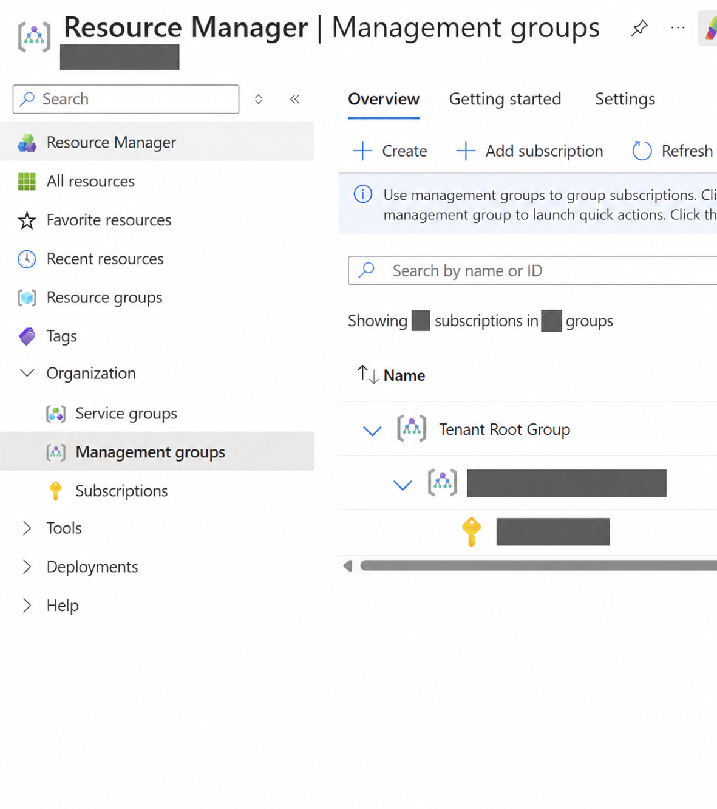
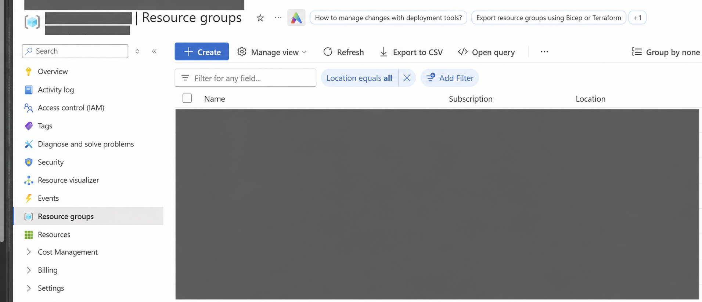
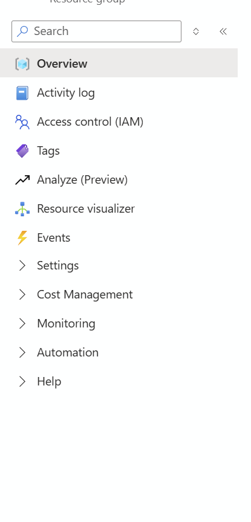
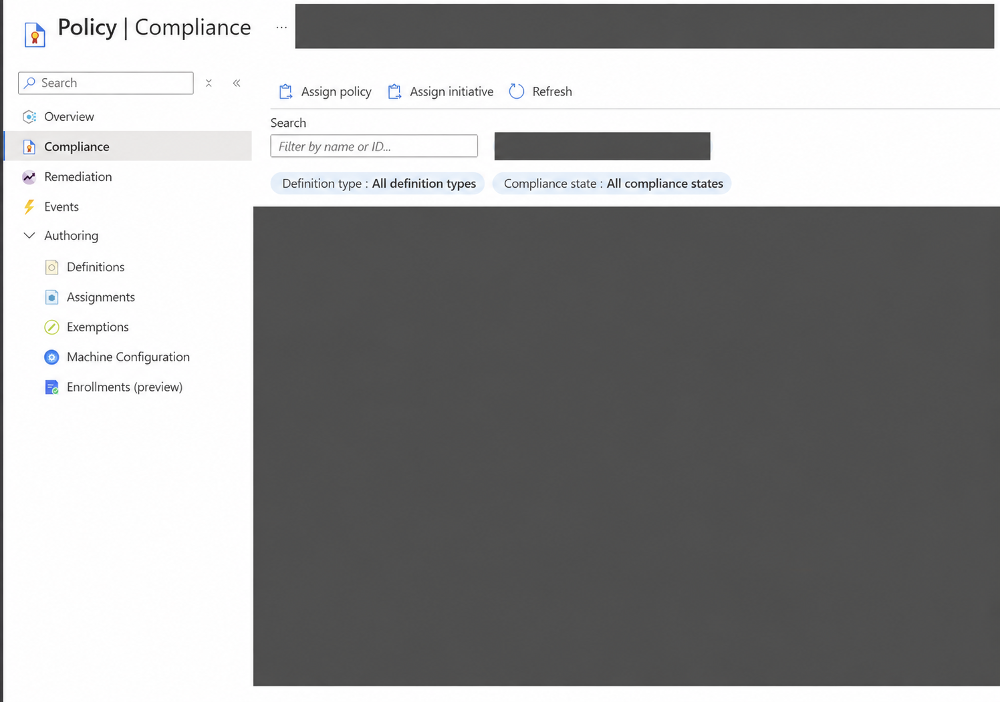

# Week 01 — Investigating Azure Resource Governance and Deployment Activity

**Mad Hat Labs | Chapter 1: The Blueprint**

**Status:** Training investigation completed; public case study based on learner notes and retrospective documentation.  
**Scenario role:** On-call Azure investigator in the exercise narrative.  
**Actual access:** Reader.  
**Environment:** Live multi-user Azure training tenant. **Not production experience.**

## Scenario

The first week of Mad Hat Labs introduced Microsoft Azure's resource hierarchy, naming conventions, tagging, deployment records, and governance policies, followed by a practical investigation. The scenario involved an inexperienced intern who deployed an experimental Azure environment without fully following organizational standards. Working with Reader access, my objective was to investigate the resources, identify potential governance failures, and document my findings while keeping all mission-specific answers confidential.

## Environment and scope

| Component | Description |
| --- | --- |
| Platform | Microsoft Azure |
| Setting | Live multi-user Azure training tenant through Mad Hat Labs |
| Access | Reader within the assigned training scope |
| Primary tool | Azure Portal |
| Review areas | Resource organization, tags, configuration, deployment history, and governance controls |
| Activity limits | Observation and documentation|

The investigation is described at a general level. Exact targets, configuration outcomes that answer the mission, and a reproducible solution sequence are withheld.

## Investigation

### Stage 1 — Resource organization and naming

**Examined:** I reviewed the subscription's resource groups and compared naming patterns.

**Found:** My notes record a naming inconsistency that warranted further review. The target and mission answer are withheld.

**Concluded:** Naming patterns help identify resources needing attention; an unusual name alone does not establish unauthorized activity.

### Stage 2 — Location, tags, and ownership context

**Examined:** I reviewed resource group locations and metadata for ownership, environment, and cost context.

**Found:** The available metadata helped frame the investigation. Lab-specific locations and tagging results are withheld.

**Concluded:** Location and tags provide context, but neither independently establishes who created or approved a resource.

### Stage 3 — Deployment history

**Examined:** I reviewed the resource group's deployment history, as recorded in my retrospective notes.

**Found:** Deployment records provided a starting point for understanding provisioning. My initial notes did not preserve a complete analysis.

**Concluded:** I cannot establish a verified timeline, deployment method, or responsible identity. Correlation with Activity Logs remains a follow-up; I do not claim to have completed it.

### Stage 4 — Governance controls

**Examined:** I reviewed Azure Policy configuration and parameters.

**Found:** My notes record a governance configuration relevant to the exercise. The parameter, value, and mission outcome are withheld.

**Concluded:** A policy's presence alone does not establish effective enforcement. Its scope, configuration, and exceptions need context.

## Evidence and Confidence

These four supplied screenshots provide limited visual context for my investigation. Identifying names, location answers, policy results, and other mission clues are withheld. The hierarchy view intentionally stops short of the answer-bearing scope. Deployment and parameter details are not displayed.

Images 01, 02, and 04 are AI-assisted redaction copies of the supplied screenshots and are provided only as navigation illustrations, not pixel-exact source evidence. Image 03 is the supplied crop. None has been independently checked against the tenant. Confidence statements below apply only to the visible interface, not to the underlying findings.

### Evidence 01 — Management groups

I used the organizational view to orient myself within Azure. **Supported:** the management groups interface and general navigation. **Not established:** the mission's target level, resource ownership, or authorization.

### Evidence 02 — Resource groups and location review

I reviewed the resource group list for naming and location context. **Supported:** the list layout and relevant column headings. **Not established:** the hidden location answer or the naming anomaly recorded in my notes.

### Evidence 03 — Resource group navigation

This cropped view preserves resource group navigation, including Settings. **Supported:** the available navigation sections. **Not established:** deployment records, timestamps, provisioning method, or attribution; those details are not visible.

### Evidence 04 — Azure Policy navigation

This view provides context for the governance review. **Supported:** the Azure Policy interface and navigation. **Not established:** the hidden parameter, its value, enforcement behavior, or a verified policy finding.

**Other limitations:** My notes also raised concerns about network accessibility and storage authorization. These remain unverified: I did not establish effective external reachability, successful authentication, accessible data, exploitation, or measurable impact.

## Overall finding

I learned to use Azure resource organization, metadata, deployment records, and governance controls to frame an investigation. The evidence supports a learning account, not a confirmed incident or independently verified vulnerability. Recognizing an unusual setting is the start of analysis; reliable conclusions require corroborating evidence.

## What surprised me and what I would improve

There were no major surprises in this exercise. My main learning curve was getting comfortable with the investigation steps and navigating the Azure Portal.

Next time, I would document my observations as I work and become more familiar with the relevant menus to make my investigation more efficient.

## Recommendations

For an authorized resource owner, I would recommend:

- Document naming, tagging, ownership, and approved exceptions.
- Correlate deployment and activity records before attributing changes or presenting a timeline.
- Validate effective access and policy applicability before proposing configuration changes.

These are proposed follow-ups, not remediation I implemented or verified.

## What I learned

- Resource organization and metadata help focus an investigation.
- Configuration observations need context before supporting claims about exposure.
- Deployment records require corroboration for reliable attribution.
- I need to capture evidence and limitations as I work.

## Training acknowledgment and disclosure

Thank you to **Mad Hat Labs** for the practical training environment. This is my independent learning portfolio, not an official course publication or endorsement.

The supplied course instruction screenshot is not republished. The four Azure evidence images are redacted presentation copies; flags, mission answers, identifying resource and deployment names, credentials, raw exports, and policy parameter values are excluded. See the [publication policy](../../PUBLICATION-POLICY.md).

**Experience classification: Live multi-user Azure training tenant, Reader access. Not production experience.**
