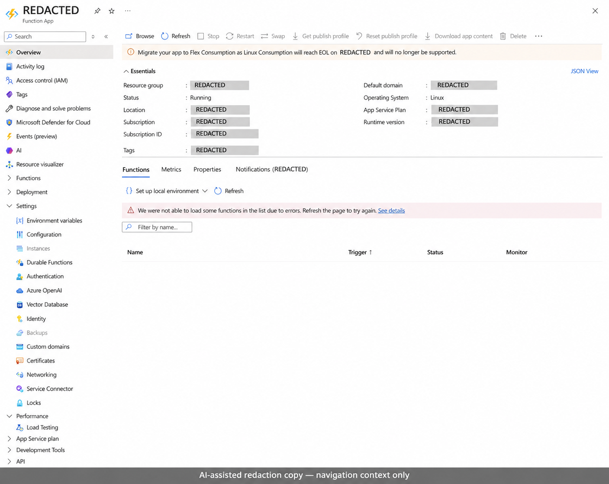
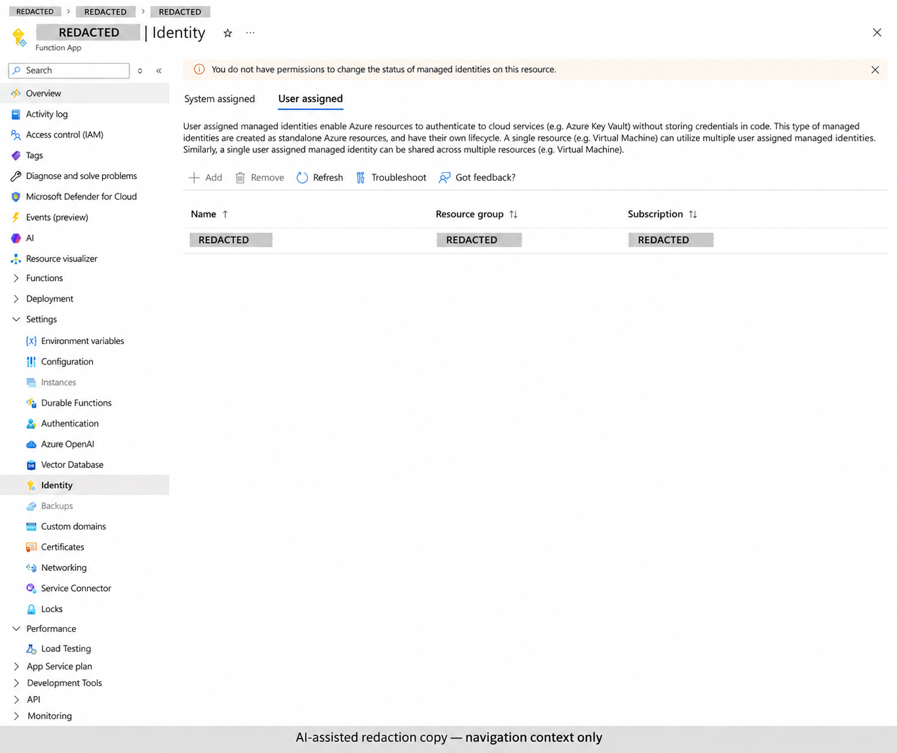
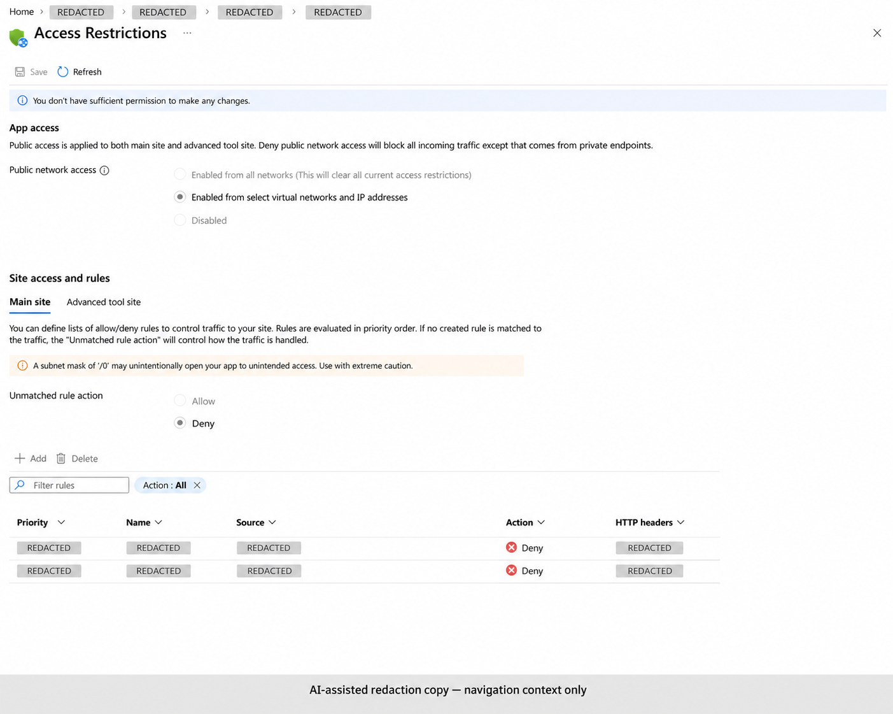
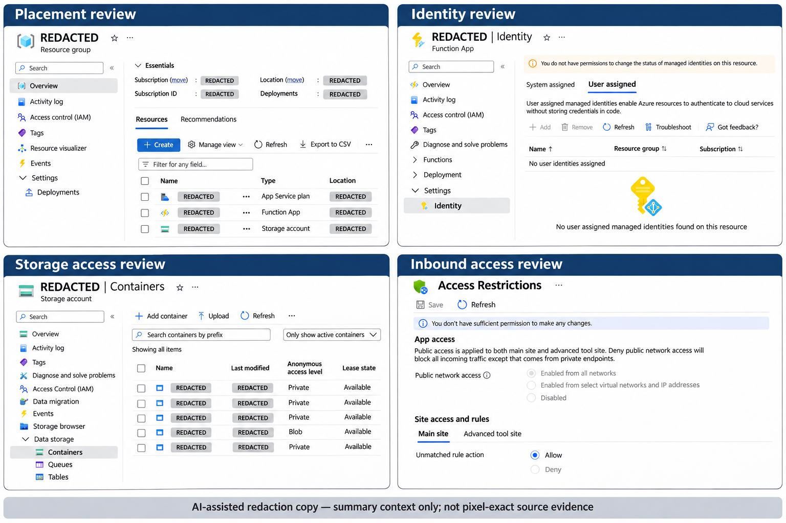

# Week 04 — Pre-Production Azure Deployment Review

**Mad Hat Labs | Chapter 4: Compute Fundamentals**

**Status:** Authorized training deployment review completed; public case study redacted under the repository publication policy.  
**Scenario role:** Cloud platform engineer reviewing a new service before production promotion.  
**Actual access:** Reader.  
**Environment:** Live multi-user Azure training tenant. **Not production experience.**

## Priority decision

I would block the production promotion until an active anonymous data exposure was contained and reviewed. The other findings still mattered, but they represented design, cost, lifecycle, or attack-surface gaps rather than a demonstrated exposure already in progress.

**Decision rule:** Exposure beats hygiene. Active beats potential.

## Context and scope

The exercise presented a newly deployed Azure notification service for review before production promotion. No written deployment standard was supplied. I derived the expected state by comparing the new deployment with an established, healthy service in the same training environment.

My Reader access allowed inspection and evidence collection but not configuration changes. I did not remediate the tenant, rotate credentials, restrict networking, or redeploy the service. The scenario and findings are training material, not a claim of production administration or employment experience.

## Method

I used five questions to structure the review:

1. **The Where:** Is the workload placed in the right region for its dependencies and requirements?
2. **The Who:** What identity does the workload use, and what permissions does it need?
3. **The Leak:** Where does its data sit, and can any of it be read without authorization?
4. **The Door:** Who can reach the service at the network and application layers?
5. **The Call:** Which finding requires action first?

For each area, I recorded the observation, compared it with the healthy baseline, considered what the evidence did and did not prove, and proposed an owner action.

## Findings

### 1. The Where — regional placement

**Observed:** The new service was placed outside the platform's established regional baseline.

**Verified by:** Comparing the overview and placement of the new deployment with the healthy service.

*Healthy comparison: AI-assisted redaction copy for navigation context only; not pixel-exact source evidence.*

**Why it matters:** A workload placed far from its actual dependencies can add latency, outbound data-transfer charges, residency concerns, and operational inconsistency.

**Evidence limit:** The new service's compute plan and its directly associated storage were co-located. I therefore treated cross-region traffic as a dependency risk to verify, not as a proven charge on every request.

**Recommendation:** Map the service's dependencies and redeploy into the approved region when required by architecture, residency, cost, or support standards.

### 2. The Who — workload identity

**Observed:** The new application had no managed identity attached, while the healthy baseline used one.

**Verified by:** Comparing the identity configuration of both services.

*Healthy comparison: AI-assisted redaction copy for navigation context only; not pixel-exact source evidence.*

**Why it matters:** Without managed identity, an application commonly relies on a stored connection string, key, or application secret. Those values can leak through code, settings, logs, images, or deployment notes.

**Evidence limit:** The missing identity did not by itself prove the exact credential used by the application.

**Recommendation:** Attach the appropriate managed identity, grant the minimum required data-plane permissions at the narrowest practical scope, update the application to request tokens, and remove the old stored credential.

### 3. The Leak — anonymous data access

**Observed:** A storage container allowed anonymous read access to an object.

**Verified by:** Opening the specific object from an authorized private-browser test with no Azure account or authenticated portal session. The object loaded successfully.

**Sanitized request pattern:** `https://[redacted-account].blob.core.windows.net/[redacted-container]/[redacted-object]`

**Why it matters:** This changed the conclusion from a theoretical misconfiguration to a demonstrated confidentiality exposure. Operational notes can reveal internal details or credentials and can support further reconnaissance.

**Evidence limit:** The test proved anonymous read access to the specific object. It did not prove anonymous modification, deletion, container listing, ownership, compromise, or wider blast radius.

**Recommendation:** Preserve the minimum authorized evidence, make the data private, disable account-level anonymous access where it is not required, review relevant logs, and rotate any credential that may have been disclosed.

### 4. The Door — inbound network access

**Observed:** The new Function App accepted public network traffic without an access-restriction baseline. The healthy service used deny-by-default behavior.

**Verified by:** Comparing the inbound networking and access-restriction configuration of both services.

*Healthy comparison: AI-assisted redaction copy for navigation context only; not pixel-exact source evidence.*

**Why it matters:** A scheduled workload that does not require inbound requests should not expose an unnecessary internet-facing path.

**Evidence limit:** Network reachability did not prove anonymous function invocation. Function authorization and application authentication would require separate validation.

**Recommendation:** Disable public access or limit it to required private endpoints, virtual networks, or approved sources. Verify both network-layer restrictions and application-layer authentication.

### 5. The Call — what gets fixed first

| Priority | Finding | Rationale | Proposed owner action |
| --- | --- | --- | --- |
| Immediate | Anonymous object read | Active and directly demonstrated data exposure | Contain access, preserve evidence, review logs, and rotate affected credentials |
| High | Open inbound path | Unnecessary attack surface on a scheduled workload | Restrict inbound access and verify application authentication |
| High | Missing managed identity | Likely reliance on a stored credential | Implement managed identity and least-privilege data-plane access |
| Planned | Nonstandard regional placement | Potential latency, transfer-cost, residency, and supportability concerns | Confirm the dependency map and align placement with the approved architecture |
| Planned | Hosting lifecycle notice | Future support and migration risk | Complete a supported hosting migration before the published deadline |

The ranking would change if new evidence established active exploitation, sensitive data impact, anonymous invocation, or a more critical business dependency.

## Remediation sequence

For an authorized resource owner, I would recommend:

1. Preserve the minimum evidence required for investigation.
2. Remove anonymous storage access and review account-level anonymous-access settings.
3. Review available logs and activity records for access beyond the validation test.
4. Rotate any key, connection string, token, or secret that may have been exposed.
5. Restrict the workload's inbound network path and verify application authentication.
6. Implement managed identity with least-privilege data-plane authorization and remove the stored credential.
7. Confirm dependency locations and correct regional placement where required.
8. Address the hosting lifecycle notice and add deployment guardrails.
9. Retest from both an unauthenticated session and the intended workload identity, then capture closure evidence.

These are recommendations, not changes I implemented or verified.

## Preventive controls

- A pre-deployment checklist covering region, identity, data access, network access, lifecycle, ownership, and rollback.
- Policy guardrails that prevent anonymous storage access and noncompliant public exposure unless explicitly approved.
- Managed identities and narrowly scoped RBAC instead of stored credentials.
- Automated configuration checks in the deployment pipeline.
- A documented baseline and post-deployment verification process.

## Evidence and publication limits

I retained the original screenshots and lab-specific evidence privately. The images published here are AI-assisted redaction copies created only to show navigation and comparison context. They are not pixel-exact source evidence and must not be used to reconstruct mission answers.

No flags, GUIDs, subscription or tenant identifiers, identity names, rule names, container names, live URLs, raw exports, credentials, original screenshots, or unredacted screenshots are included here. One nonfunctional URL pattern is retained to explain the validation method without revealing the target. The unauthenticated validation is described only at the level needed to explain the evidence standard.

### Redacted evidence comparison

*Unhealthy deployment summary: AI-assisted redaction copy for comparison context only; not pixel-exact source evidence.*

## What I learned

- A healthy implementation can provide a practical baseline when written standards are incomplete.
- A difference from baseline is a question to investigate, not automatically a vulnerability.
- Proving a narrowly scoped exposure is stronger than making a broad claim from a portal setting.
- Anonymous Blob read access does not imply anonymous write, delete, ownership, or container listing.
- Public network reachability does not by itself prove anonymous application invocation.
- Active exposure should be contained before lower-urgency configuration hygiene is addressed.
- A technical review is most useful when it ends with a clear priority decision a nontechnical leader can act on.

## Training acknowledgment and disclosure

Thank you to **Mad Hat Labs** for the practical training environment and deployment-review exercise. This is my independent portfolio reflection, not an official course publication or endorsement.

The scenario is summarized in my own words. Mission answers, target identifiers, exact navigation sequences, and raw evidence are withheld under the [publication policy](../../PUBLICATION-POLICY.md).

**Experience classification: Live multi-user Azure training tenant, Reader access. Not production experience.**

## End note

[Interview-ready summary — Week 4 Lab Work and Industry Thinking](#priority-decision)
